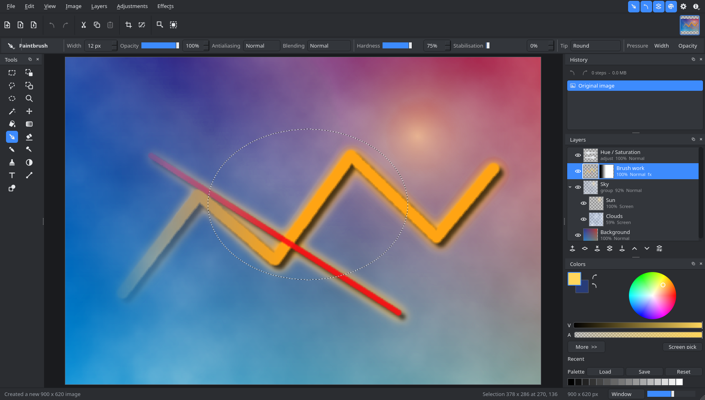
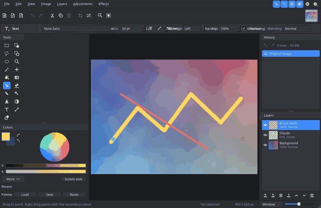
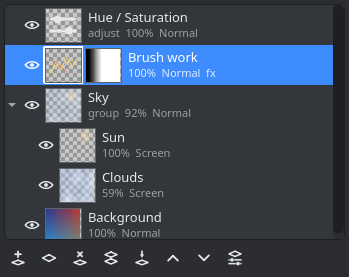
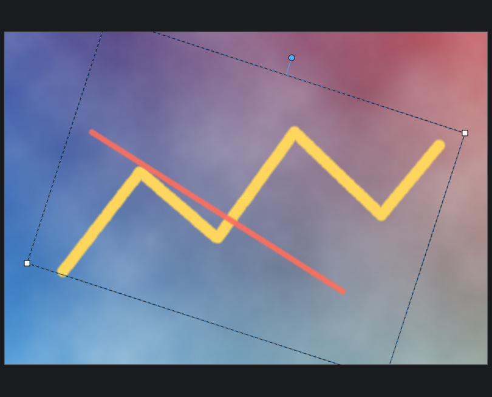
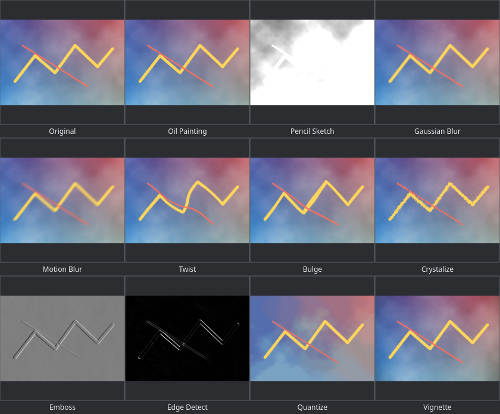
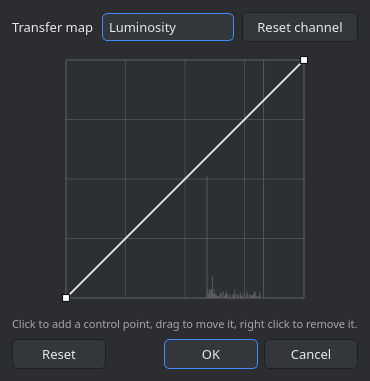
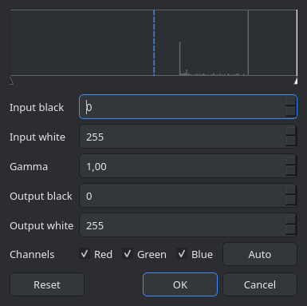
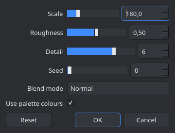

# Tessel

A layered raster image editor for Linux, written from scratch in C++20 with Qt 6.
It follows the way of working that Paint.NET made popular: a tool palette on the
left, Colors below it, History and Layers on the right, a tool options bar under
the main toolbar, and a status bar that always tells you where the cursor is,
how big the selection is and what the zoom level is.

| Panels | Rotate and zoom gizmo | Effects |
| --- | --- | --- |
|  |  |  |

| Curves | Levels | Effect dialogs |
| --- | --- | --- |
|  |  |  |

There is a light theme too, in [docs/screenshots/main-light.png](docs/screenshots/main-light.png).

## About the name and the inspiration

Tessel is an independent program. It is not a port of Paint.NET and shares no code
with it: Paint.NET is closed source, Windows only and built on .NET, so no port
of it can exist. What Tessel borrows is the workflow and the layout, both of which
are implemented here from the ground up, including every icon, which is drawn
procedurally with QPainter rather than loaded from a file.

## Downloading a build

Every release carries a Linux tarball and a Windows zip, both built and tested
by CI: https://github.com/ExPikaPaka/tessel/releases

The Windows zip has the Qt runtime beside the executable, so it runs from the
folder it is unpacked into. The Linux tarball links against the system Qt 6.

## Building

Requirements: a C++20 compiler, CMake 3.21 or newer, Qt 6.4 or newer (Widgets),
and zlib. The same source builds with MSVC on Windows; CI does it with Qt from
the official installer and zlib from vcpkg.

    cmake -S . -B build -G Ninja -DCMAKE_BUILD_TYPE=Release
    cmake --build build
    ./build/tessel

To install system wide, together with its desktop entry and icon:

    sudo cmake --install build

On Arch and derivatives the dependencies are `qt6-base`, `cmake`, `ninja` and
`gcc`. On Debian and Ubuntu they are `qt6-base-dev`, `cmake`, `ninja-build`,
`g++` and `zlib1g-dev`. Qt Test is part of Qt 6 base and is used by the
interface test suite.

## Running the tests

    ctest --test-dir build --output-on-failure

Two suites run: `core` covers the pixel engine, documents, undo history and file
formats without a display, and `gui` drives the real widgets, tools and effects
through the offscreen Qt platform plugin.

## What it can do

### Tools

Rectangle Select, Lasso Select, Ellipse Select and Magic Wand, each with the five
combine modes (replace, union, subtract, intersect, exclusive or) and with Ctrl
and Alt as live modifiers. Move Selected Pixels lifts the selection onto a
floating buffer that can be dragged, nudged with the arrow keys and scaled from
its corner handles; Move Selection slides the outline on its own.

Paintbrush, Pencil, Eraser, Paint Bucket, Gradient (linear, reflected, radial,
conical and diamond, in colour or transparency mode, with optional dithering),
Clone Stamp, Recolor, Color Picker, Text, Line and Curve, Shapes (thirty of
them), Zoom and Pan.

The right mouse button draws with the secondary colour, the space bar pans with
any tool, and every drawing tool is clipped to the active selection.

### Adjustments

Auto Level, Black and White, Brightness / Contrast, Color Balance, Color
Temperature, Curves, Hue / Saturation, Invert Alpha, Invert Colors, Levels,
Posterize, Sepia and Threshold. Curves and Levels have dedicated dialogs with the channel
histogram behind the controls.

### Effects

* Artistic: Oil Painting, Pencil Sketch, Ink Sketch, Mosaic Tiles
* Blurs: Gaussian, Unfocus, Motion, Radial, Zoom, Fragment, Surface Blur
* Color: Quantize, Duotone
* Distort: Bulge, Twist, Polar Inversion, Tile Reflection, Dents, Frosted Glass,
  Pixelate, Crystalize
* Noise: Add Noise, Median, Reduce Noise
* Object: Drop Shadow, Outline Object, Outer Glow
* Photo: Sharpen, Glow, Vignette, Soft Portrait, Red Eye Removal
* Render: Clouds, Julia Fractal, Mandelbrot Fractal, Checkerboard
* Stylize: Edge Detect, Emboss, Relief, Outline

Every effect dialog is generated from the effect's parameter list and previews
live on the canvas; Ctrl+F repeats the last one with the same settings. The list
is not fixed: see Plugins below.

### Layers

Any number of layers, each with its own name, visibility, opacity and blend
mode. The fourteen blend modes are Normal, Multiply, Additive, Color Burn, Color
Dodge, Reflect, Glow, Overlay, Difference, Negation, Lighten, Darken, Screen and
Xor. Layers can be added, deleted, duplicated, reordered, merged down, flattened,
flipped, rotated and zoomed, and imported from any readable image file.

### History

Every edit is undoable, and the History window lists them all so you can jump to
any point in the session. Brush strokes store only the rectangle they touched,
so a long session stays cheap; the stack is capped by both step count and memory.

### File formats

* `.tessel`, the native format: a zip holding one PNG per layer, a JSON manifest,
  the selection and a flattened preview
* `.ora` (OpenRaster), which keeps layers, opacity and blend modes and is read by
  Krita, GIMP and MyPaint
* PNG, JPEG, BMP, TIFF, WebP, TGA, GIF, ICO and anything else the Qt image
  plugins on the system can handle

Paint.NET's own `.pdn` files cannot be read, because the format is an
undocumented serialisation of .NET objects. Tessel says so plainly when one is
opened and suggests exporting `.ora` or `.png` from Paint.NET instead.

## Plugins

Effects can be written outside the program and loaded at startup, the way
Paint.NET takes plugin DLLs. A plugin is a shared library holding one class, and
the effects inside it are declared exactly the way the built in ones are: a
lambda and a list of parameters. Whatever loads appears in the Effects menu under
the submenu it asked for, with the same generated dialog and the same live
preview.

Tessel reads a `plugins` directory in each of these places at startup, in this
order:

* the per user application data directory, which on Linux is
  `~/.local/share/Tessel/Tessel/plugins`
* the system wide ones, such as `/usr/share/Tessel/Tessel/plugins`
* `plugins` beside the executable, which is what makes `build/plugins` work in a
  build tree

The program prints the list it actually used, under Effects > About the Plugins.
That dialog also names every plugin that loaded, the effects each one brought,
and every file that was refused together with the reason; a failure is announced
in the status bar at startup as well. A plugin built against a different version
of the interface is refused by name rather than loaded, because the two sides
pass C++ objects to each other.

The whole contract is one documented header, `src/effects/EffectPlugin.h`: derive
a class from QObject and `tessel::EffectPlugin`, say what the plugin is called,
and add effects to the registry you are handed. `plugins/example` is a working
plugin with three parameters, built by this project behind an option that is off
by default:

    cmake -S . -B build -G Ninja -DTESSEL_BUILD_EXAMPLE_PLUGIN=ON
    cmake --build build
    ./build/tessel          # Effects > Examples > Scanlines

[docs/plugins.html](docs/plugins.html) walks through writing and installing one,
with the example's source quoted in full.

## Keyboard

Press F1 inside the program for the full list. The tool letters are S for the
selection tools (press it again to cycle), M for the two move tools, B
paintbrush, P pencil, E eraser, F paint bucket, G gradient, K colour picker, L
clone stamp, R recolor, T text, O line and shapes, Z zoom and H pan. X swaps the
palette colours and D resets them.

Shortcuts that hold Ctrl or Alt are matched by the key's position, so they keep
working while a non Latin keyboard layout is active.

## How the code is laid out

    src/core      pixel engine: Image, blend modes, ImageOps, Document, Layer,
                  Selection, History, zip and file formats. No GUI dependency,
                  which is why the core tests run headless.
    src/effects   the effect registry and the effects themselves, each one a
                  lambda plus a parameter list, plus the plugin interface and
                  the loader that reads the plugins directories
    plugins       the example effect plugin
    src/tools     the Tool interface, the shared stroke engine and all 19 tools
    src/ui        the window, canvas view, docks, colour panel and dialogs
    tests         the two test suites

Pixel work is parallelised over scanlines with a small `parallelFor`, blurs use a
three pass box approximation of a gaussian, and resampling is done in
premultiplied alpha so transparent edges do not bleed.

## Regenerating the screenshots

The images in this README are rendered by a small tool that drives the real
widgets through the offscreen platform plugin, so it needs no display:

    cmake -S . -B build -G Ninja -DTESSEL_BUILD_SCREENSHOT_TOOL=ON
    cmake --build build
    ./build/tessel_screenshots docs/screenshots

Continuous integration runs the same tool on every push and keeps the result as
a build artifact, which makes an accidental change to the interface visible.

## Licence

Written for this repository. Qt is used under the LGPL, so the dynamic linking
here keeps that licence intact.
