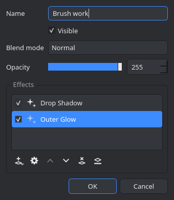
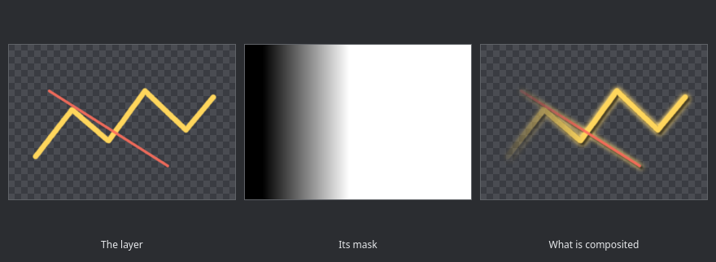
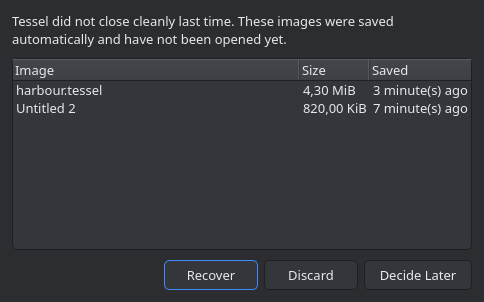

# Tessel

A layered raster image editor for Linux, written from scratch in C++20 with Qt 6.
It follows the way of working that Paint.NET made popular: a tool palette on the
left, History, Layers and Colors on the right, a tool options bar under the main
toolbar, and a status bar that always tells you where the cursor is, how big the
selection is and what the zoom level is.

The options bar belongs to whichever tool is active. The Paintbrush brings a
width, an opacity, an antialiasing level, a blend mode, hardness, stabilisation,
a brush tip and the two tablet pressure switches:

| Layers: a group, a masked layer, an adjustment layer | Layer Properties, with the layer's effect stack | What a layer mask does |
| --- | --- | --- |
|  |  |  |

| Rotate and zoom gizmo | Effects | Recovery after a crash |
| --- | --- | --- |
|  |  |  |

| Curves | Levels | Effect dialogs |
| --- | --- | --- |
|  |  |  |

There is a light theme too, in [docs/screenshots/main-light.png](docs/screenshots/main-light.png).

## About the name and the inspiration

Tessel is an independent program. It is not a port of Paint.NET and shares no code
with it: Paint.NET is closed source, Windows only and built on .NET, so no port
of it can exist. What Tessel borrows is the workflow and the layout, both of which
are implemented here from the ground up, including every icon, which is drawn
procedurally with QPainter rather than loaded from a file.

## Downloading a build

Every release carries a Linux tarball and a Windows zip, both built and tested
by CI: https://github.com/ExPikaPaka/tessel/releases

The Windows zip has the Qt runtime beside the executable, so it runs from the
folder it is unpacked into. The Linux tarball links against the system Qt 6.

## Building

Requirements: a C++20 compiler, CMake 3.21 or newer, Qt 6.4 or newer (Widgets),
and zlib. The same source builds with MSVC on Windows; CI does it with Qt from
the official installer and zlib from vcpkg.

    cmake -S . -B build -G Ninja -DCMAKE_BUILD_TYPE=Release
    cmake --build build
    ./build/tessel

To install system wide, together with its desktop entry and icon:

    sudo cmake --install build

On Arch and derivatives the dependencies are `qt6-base`, `qt6-tools`, `cmake`,
`ninja` and `gcc`. On Debian and Ubuntu they are `qt6-base-dev`,
`qt6-tools-dev`, `qt6-l10n-tools`, `cmake`, `ninja-build`, `g++` and
`zlib1g-dev`. Qt Test is part of Qt 6 base and is used by the interface test
suite; the Qt Linguist tools come from the packages named above and compile the
translations. A build without them is English only.

## Running the tests

    ctest --test-dir build --output-on-failure

Two suites run: `core` covers the pixel engine, documents, undo history and file
formats without a display, and `gui` drives the real widgets, tools and effects
through the offscreen Qt platform plugin.

## What it can do

### Tools

Rectangle Select, Lasso Select, Ellipse Select and Magic Wand, each with the five
combine modes (replace, union, subtract, intersect, exclusive or) and with Ctrl
and Alt as live modifiers. Move Selected Pixels lifts the selection onto a
floating buffer that can be dragged, nudged with the arrow keys and scaled from
its corner handles; Move Selection slides the outline on its own. Edit >
Selection feathers, grows, shrinks or reduces the outline to a border of a
given width.

Paintbrush, Pencil, Eraser, Paint Bucket, Gradient (linear, reflected, radial,
conical and diamond, in colour or transparency mode, with optional dithering),
Clone Stamp, Recolor, Color Picker, Text, Line and Curve, Shapes (thirty of
them), Zoom and Pan.

The right mouse button draws with the secondary colour, the space bar pans with
any tool, and every drawing tool is clipped to the active selection.

The painting tools answer a graphics tablet. Pressure can drive the width of
the stroke, its opacity, or both; each is a switch of its own in the options
bar and both start off, so a mouse behaves exactly as it always did. Beside
them sit stabilisation, which averages the last few positions of the pointer
so a slow line stops wobbling, and a Tip box that paints with a brush shape
loaded from a PNG instead of the built in round one. Antialiasing is a level
now (None, Low, Normal, High, Maximum) rather than a switch, and the Blending
box carries one entry past the blend modes, Overwrite, which replaces what is
under the brush instead of compositing onto it.

### Adjustments

Auto Level, Black and White, Brightness / Contrast, Color Balance, Color
Temperature, Curves, Hue / Saturation, Invert Alpha, Invert Colors, Levels,
Posterize, Sepia and Threshold. Curves and Levels have dedicated dialogs with the channel
histogram behind the controls.

### Effects

* Artistic: Oil Painting, Pencil Sketch, Ink Sketch, Mosaic Tiles
* Blurs: Gaussian, Unfocus, Motion, Radial, Zoom, Fragment, Surface Blur
* Color: Quantize, Duotone
* Distort: Bulge, Twist, Polar Inversion, Tile Reflection, Dents, Frosted Glass,
  Pixelate, Crystalize
* Noise: Add Noise, Median, Reduce Noise
* Object: Drop Shadow, Outline Object, Outer Glow
* Photo: Sharpen, Glow, Vignette, Soft Portrait, Red Eye Removal
* Render: Clouds, Julia Fractal, Mandelbrot Fractal, Checkerboard
* Stylize: Edge Detect, Emboss, Relief, Outline

Every effect dialog is generated from the effect's parameter list and previews
live on the canvas; Ctrl+F repeats the last one with the same settings. The list
is not fixed: see Plugins below.

Every adjustment and every effect can also be used without touching a pixel,
as an adjustment layer or as an entry in a layer's effect stack: see Layers.

### Layers

Layers are a tree. Any number of them, each with its own name, visibility,
opacity and blend mode, and a group has all four as well: the group's children
are flattened and then the group's own opacity, blend mode and mask are applied
to the result. Add Group is Ctrl+Shift+G, and a layer is dragged into or out of
a group in the Layers panel. The fourteen blend modes are Normal, Multiply,
Additive, Color Burn, Color Dodge, Reflect, Glow, Overlay, Difference, Negation,
Lighten, Darken, Screen and Xor. Layers can be added, deleted, duplicated,
reordered, merged down, flattened, flipped, rotated and zoomed, and imported
from any readable image file.

Any layer, group included, can carry an **8 bit mask** that scales its alpha
while it is composited. The mask is an ordinary grey raster, so it is painted
with the same brushes, gradients and effects as everything else, clipped by the
selection the same way: click the second thumbnail in the layer's row and the
tools write there instead. Layers > Layer Mask holds Add, Paint in Mask, Enable, Invert, Apply
(which bakes the mask into the pixels and drops it) and Delete.

**Adjustment layers** hold an effect rather than pixels, and apply it to
everything composited below them inside their group. Layers > New Adjustment
Layer lists every adjustment and every effect, including the ones plugins
brought. Double clicking the layer reopens its parameters, for as long as the
layer exists.

An ordinary layer can carry a **stack of effects** instead, applied to its
pixels on the way into the composite while the stored pixels are left alone.
The stack is edited in Layer Properties (F4): add, reorder, disable or remove
an entry, reopen any entry's parameters, or Flatten the stack into the pixels
when it is settled. An entry naming an effect this build does not have, a
plugin that is not installed, passes the pixels through rather than dropping
them, so the document still opens, composites and saves.

### History

Every edit is undoable, and the History window lists them all so you can jump to
any point in the session. Brush strokes store only the rectangle they touched,
so a long session stays cheap; the stack is capped by both step count and memory.

### File formats

* `.tessel`, the native format: a zip holding one PNG per layer, a JSON manifest,
  the selection and a flattened preview. The manifest nests, so groups, layer
  masks, adjustment layers and effect stacks all come back as they went in
* `.ora` (OpenRaster), which keeps layers, opacity and blend modes and is read by
  Krita, GIMP and MyPaint. Groups travel as nested stacks. OpenRaster has
  neither masks nor adjustment layers, so a mask is baked into the pixels that
  are written, and the layers under an adjustment layer are written as the one
  layer they composite to, with the adjustment already in them. The file looks
  the same when it is read back; what is lost is the separation
* PNG, JPEG, BMP, TIFF, WebP, TGA, GIF, ICO and anything else the Qt image
  plugins on the system can handle

Paint.NET's own `.pdn` files cannot be read, because the format is an
undocumented serialisation of .NET objects. Tessel says so plainly when one is
opened and suggests exporting `.ora` or `.png` from Paint.NET instead.

### Autosave and recovery

Every changed image is written to a recovery copy on a timer, by default every
two minutes, on a worker thread so nothing waits for the disk. The copies live
in a locked directory of their own under the user data directory, one per run.
A run that ends cleanly deletes its directory; a run that does not leaves it
behind, and the next start notices the lock of a dead process, lists what it
found and offers to Recover it, Discard it, or decide later. Abandoned files
are deleted unasked once they are older than the number of days in Settings.

Tessel also remembers the images that were open and offers to reopen them at
the next start. Autosave, its interval, the reopen offer and how long recovery
files are kept are all in Settings, under Saving work.

## Plugins

Effects can be written outside the program and loaded at startup, the way
Paint.NET takes plugin DLLs. A plugin is a shared library holding one class, and
the effects inside it are declared exactly the way the built in ones are: a
lambda and a list of parameters. Whatever loads appears in the Effects menu under
the submenu it asked for, with the same generated dialog and the same live
preview.

Tessel reads a `plugins` directory in each of these places at startup, in this
order:

* the per user application data directory, which on Linux is
  `~/.local/share/Tessel/Tessel/plugins`
* the system wide ones, such as `/usr/share/Tessel/Tessel/plugins`
* `plugins` beside the executable, which is what makes `build/plugins` work in a
  build tree

The program prints the list it actually used, under Effects > About the Plugins.
That dialog also names every plugin that loaded, the effects each one brought,
and every file that was refused together with the reason; a failure is announced
in the status bar at startup as well. A plugin built against a different version
of the interface is refused by name rather than loaded, because the two sides
pass C++ objects to each other.

The whole contract is one documented header, `src/effects/EffectPlugin.h`: derive
a class from QObject and `tessel::EffectPlugin`, say what the plugin is called,
and add effects to the registry you are handed. `plugins/example` is a working
plugin with three parameters, built by this project behind an option that is off
by default:

    cmake -S . -B build -G Ninja -DTESSEL_BUILD_EXAMPLE_PLUGIN=ON
    cmake --build build
    ./build/tessel          # Effects > Examples > Scanlines

[docs/plugins.html](docs/plugins.html) walks through writing and installing one,
with the example's source quoted in full.

## Keyboard

Press F1 inside the program for the full list. The tool letters are S for the
selection tools (press it again to cycle), M for the two move tools, B
paintbrush, P pencil, E eraser, F paint bucket, G gradient, K colour picker, L
clone stamp, R recolor, T text, O line and shapes, Z zoom and H pan. X swaps the
palette colours and D resets them.

Shortcuts that hold Ctrl or Alt are matched by the key's position, so they keep
working while a non Latin keyboard layout is active. The complete list, with
the new Add Group, Free Transform and Feather keys in it, is on
[docs/shortcuts.html](docs/shortcuts.html).

## Languages

The interface ships in English and Russian. By default Tessel follows the
system locale; Settings (the gear in the top right corner) has a Language box
with System, English and Russian, and the choice takes effect the next time the
program starts. Qt's own translations, which cover the standard dialog buttons
and the file chooser, are loaded from the Qt installation for the same
language.

Every language lives in one file under `translations/`, named after its locale,
and is compiled to a `.qm` by lrelease during an ordinary build. The `.qm`
files are embedded in the executable as a resource under `/i18n`, so a single
binary carries all of them and there is nothing to install beside it. The
Linguist tools are optional: without them the build simply has no translations
and the English source text is used.

To add a language, say French:

1. Create `translations/tessel_fr.ts` and add it to the `TS_FILES` of the
   `qt_add_translations` call in `CMakeLists.txt`.
2. Fill it with the strings in the source:

       cmake --build build --target update_translations

   lupdate reads everything under `src/` and writes one entry per string. Run
   it again whenever a string changes; `-no-obsolete` keeps the file free of
   entries nothing uses any more.
3. Translate, by hand or in Qt Linguist:

       linguist translations/tessel_fr.ts

   Keep the `%1`, `%2` and `%n` markers, keep one `&` in every menu entry (it
   is the Alt mnemonic, and the letters have to stay unique within a menu),
   and fill in all three forms of a plural message where the language has
   three. The `gui` test suite checks that no translation lost a placeholder.
4. Add the language to the box in Settings: one `addItem` in
   `MainWindow::showSettings`, with the locale name as the item's data.
5. Build. The `.qm` is compiled and embedded automatically, and
   `LANG=fr_FR.UTF-8 ./build/tessel` shows the result.

Strings that are matched on rather than read are deliberately not translated:
the blend mode names the file format stores, the unit and tool ids, the effect
category keys and the icon names. Each of those has a separate display
spelling, such as `blendModeLabel` beside `blendModeName`.

## How the code is laid out

    src/core      pixel engine: Image, blend modes, ImageOps, Document, the
                  layer tree with its masks and effect stacks, Selection,
                  History, autosave and recovery, zip and file formats. No GUI
                  dependency, which is why the core tests run headless.
    src/effects   the effect registry and the effects themselves, each one a
                  lambda plus a parameter list, plus the plugin interface and
                  the loader that reads the plugins directories
    plugins       the example effect plugin
    src/tools     the Tool interface, the shared stroke engine and all 19 tools
    src/ui        the window, canvas view, docks, colour panel and dialogs
    translations  one .ts file per language, compiled into the binary
    tests         the two test suites

Pixel work is parallelised over scanlines with a small `parallelFor`, blurs use a
three pass box approximation of a gaussian, and resampling is done in
premultiplied alpha so transparent edges do not bleed.

The composite is cached in a grid of 64 pixel tiles: an edit dirties only the
tiles its rectangle touches, so painting in the corner of a large image costs
what the corner costs rather than what the image costs. Effects are the
exception and are deliberately kept out of the tiles, because a blur or a
distortion reads neighbouring pixels and a tile computed from its own backdrop
would disagree with its neighbours along every seam; a layer carrying an
enabled effect, and a level holding an adjustment layer, are built once at
canvas size and the tiles window into that one result.

## Regenerating the screenshots

The images in this README are rendered by a small tool that drives the real
widgets through the offscreen platform plugin, so it needs no display:

    cmake -S . -B build -G Ninja -DTESSEL_BUILD_SCREENSHOT_TOOL=ON
    cmake --build build
    ./build/tessel_screenshots docs/screenshots

Continuous integration runs the same tool on every push and keeps the result as
a build artifact, which makes an accidental change to the interface visible.

## Licence

Written for this repository. Qt is used under the LGPL, so the dynamic linking
here keeps that licence intact.
